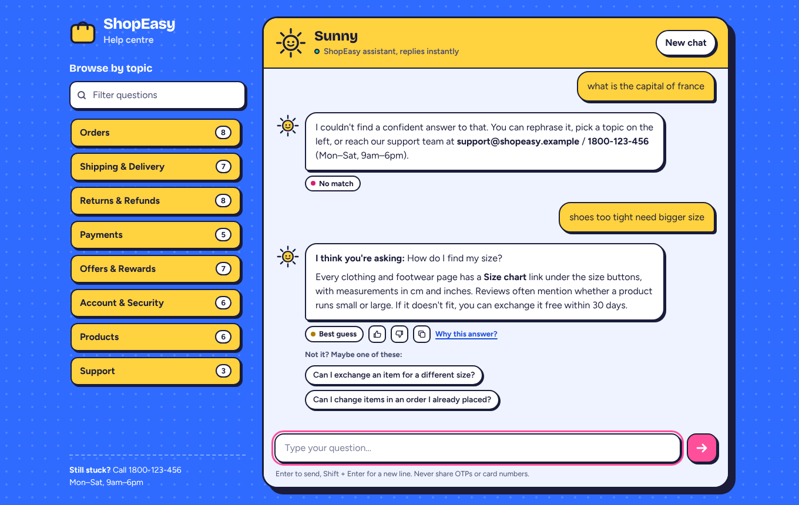

# CodeAlpha_FAQChatbot

Sunny is a help-desk chatbot for **ShopEasy**, a fictional Indian online store. It answers 50 customer FAQs across 8 topics (orders, delivery, returns, payments, offers, account, products, support). Users can type questions in their own words, with typos, chat slang or a bit of Hinglish.



## Run it

```bash
pip install -r requirements.txt
python app.py              # open http://127.0.0.1:5000
python faq_engine.py       # or chat in the terminal
python evaluate.py         # accuracy report vs. the first version
python -m pytest -v        # 34 automated tests (engine + web API)
```

NLTK data (`punkt_tab`, `stopwords`, `wordnet`) downloads automatically on first run.

## How it answers a question

| Step | What happens | Example |
|---|---|---|
| Normalise | lowercase, expand contractions, chat slang & Hinglish | `wheres ur parcel?` → `where is your parcel` |
| Spell-correct | only words unknown to both English and the shop vocabulary | `cancle` → `cancel`, `pasword` → `password` |
| Synonyms | 25 groups map phrases to one term | `money back` → `refund`, `GPay` → `upi` |
| NLTK | tokenise, remove stopwords (but keep *not*), WordNet lemmatise | `returned items` → `return item` |
| Score | 4 signals blended per FAQ (below) | |
| Decide | confident answer, best guess with alternatives, or "I don't know" | |

**Similarity signals** (each FAQ has its main question plus 3 paraphrases):

- **Question match:** word + bigram TF-IDF cosine against the best of the FAQ's phrasings (40%)
- **Spelling-tolerant match:** character n-gram TF-IDF cosine (20%)
- **Answer match:** TF-IDF cosine against the answer text and keywords (15%)
- **Words covered:** share of the user's words (IDF-weighted) that the FAQ knows. This is the signal that stops off-topic questions from being answered (25%)
- *Optional* **meaning match:** sentence embeddings (`all-MiniLM-L6-v2`) when `sentence-transformers` is installed

**Chat behaviour:**

- small talk (hi, thanks, bye, "are you a bot?", frustration)
- two questions in one message are both answered
- short follow-ups like *"what about COD?"* are read with the previous answer
- a warning if someone types a card number or OTP
- "people also ask" suggestions
- 👍/👎 feedback, plus a log of unanswered questions in `logs/` so you can find gaps in the knowledge base

## Results

`evaluate.py` runs 98 held-out questions (90 in scope with typos, slang and indirect phrasing, plus 8 off-topic ones) through both engines on the same knowledge base:

| Metric | Original | New |
|---|---|---|
| Right FAQ picked (top-1) | 64.4% | **87.8%** |
| Wrong FAQ given as a confident answer | 33.3% | **3.3%** |
| Off-topic question answered confidently | 25.0% | **0.0%** |

When the new engine isn't sure, it shows its best guess along with alternatives instead of a wrong answer. The decision thresholds were tuned on this same small set, so treat the numbers as indicative, not a benchmark.

## Project layout

```
app.py               Flask server + JSON API (/api/chat, /api/faq/<id>, /api/feedback)
faq_engine.py        matching, decisions, small talk, follow-ups, multi-question
nlp.py               NLTK preprocessing pipeline
knowledge_base.json  bot settings, synonyms, 50 FAQs (question, paraphrases, answer, related)
evaluate.py          accuracy report
tests/               held-out evaluation questions
templates/, static/  chat UI (plain HTML/CSS/JS, fonts bundled for offline use)
```

**Use your own topic:** edit `knowledge_base.json`. Each FAQ needs an `id`, `category`, `question`, a few `variants` (other ways people ask it) and an `answer`. Answers support `**bold**` and `- ` lists.
